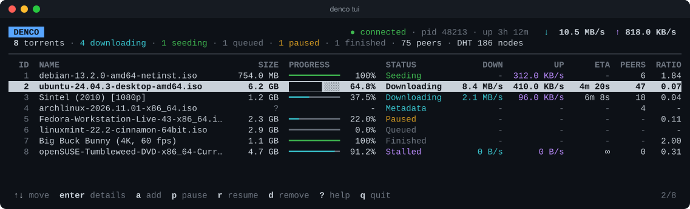
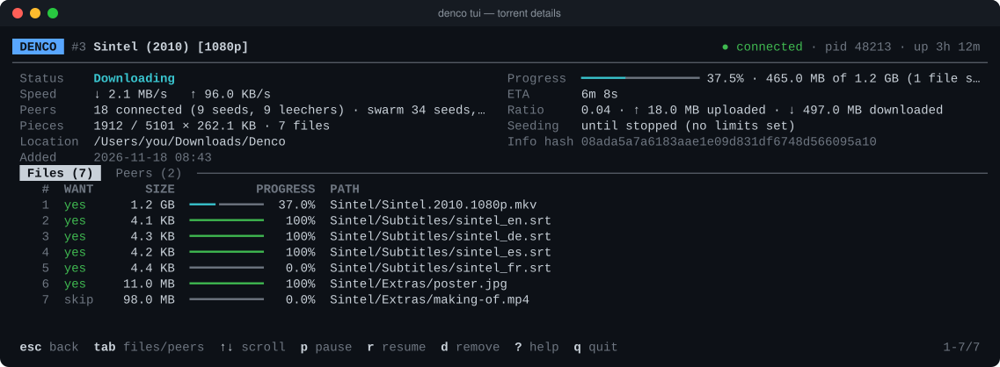

# Denco

[](https://github.com/7Eshaan/Denco/actions/workflows/ci.yml)

A daemon-based BitTorrent client for the command line, written in Go with zero dependencies.

A background **daemon** keeps your torrents running, and a small **`denco`
CLI** controls it. Runs on macOS, Linux and Windows, using only the Go
standard library — no third-party packages, no cgo.



Prefer plain commands? Everything works without the dashboard too:

```
$ denco list
Downloading (1)
ID  NAME                             SIZE      PROGRESS  STATUS       DOWN      UP     ETA    PEERS  RATIO
1   debian-13.7.0-amd64-netinst.iso  792.7 MB  59.8%     Downloading  4.6 MB/s  0 B/s  1m 9s  46     0.00
```

## Features

- `.torrent` files, `http(s)` links to them, and **magnet links** (metadata
  fetched from peers, BEP 9)
- HTTP and UDP trackers (BEP 3, 12, 15), **DHT** (BEP 5), **peer exchange**
  (BEP 11) — DHT and PEX are never used for private torrents
- **IPv6** throughout: IPv6 peers, an IPv6 DHT next to the IPv4 one
  (BEP 32), and trackers hear from us over both (BEP 7)
- Multi-file torrents, **choosing files** (skip/want, also while running)
- Rarest-first piece picking, endgame, tit-for-tat choking, seeding
- **Resume** across restarts and crashes (only pieces that could be stale
  are rechecked)
- **Speed limits:** global totals plus per-torrent limits (`denco limit`),
  changeable while running; fair to every peer
- **Seeding controls:** ratio and time limits, per-torrent seed on/off,
  pause uploads only
- **Port forwarding** on your router with UPnP or NAT-PMP
- **Terminal dashboard** (`denco tui`): live progress, speeds, peers and
  files, with pause, resume, add and remove from the keyboard
- **Download queue:** `max_active_downloads` at once, reorder with
  `denco queue` or the dashboard, force-start past the limit
- The daemon starts by itself when you run a command; automatic retry of
  failed torrents, log file
- Safe by design: paths from a torrent never escape the download folder, and
  Denco never overwrites files it didn't create

## Install

### Download a prebuilt binary

Get the archive for your system from the
[latest release](https://github.com/7Eshaan/Denco/releases/latest):
`darwin` is macOS, `arm64` is Apple Silicon / ARM, `amd64` is Intel / AMD.
Unpack it and put `denco` (`denco.exe` on Windows) in a folder on your
`PATH`. `SHA256SUMS` lists the checksums if you want to check the download.

The binaries aren't code-signed, so the first run needs one extra step:

- **macOS** blocks downloaded programs. Run
  `xattr -d com.apple.quarantine denco` once.
- **Windows** SmartScreen may warn: choose *More info → Run anyway*.

`denco version` shows which version you have.

### Build from source

Needs [Go](https://go.dev/dl/) 1.23 or newer.

```sh
git clone https://github.com/7Eshaan/Denco.git
cd Denco
go install ./cmd/denco
```

This puts the `denco` binary in Go's bin folder. To run plain `denco` from
any folder, that folder must be on your `PATH`:

- **macOS** (zsh): `echo 'export PATH="$PATH:$HOME/go/bin"' >> ~/.zshrc`,
  then open a new terminal.
- **Linux** (bash): `echo 'export PATH="$PATH:$HOME/go/bin"' >> ~/.bashrc`,
  then open a new terminal. If you installed Go from the tarball, add
  `/usr/local/go/bin` the same way.
- **Windows:** the Go installer already adds `%USERPROFILE%\go\bin`; just
  open a new terminal.

Check it works with `denco help`. To build without installing, run
`go build -o denco ./cmd/denco` (`denco.exe` on Windows) and use `./denco`.

## Quick start

```sh
denco add ~/Downloads/some.torrent          # or a magnet link, or an https:// URL
denco list                                  # what's going on
denco info 1                                # details of torrent #1
denco tui                                   # live dashboard (? lists the keys)
denco stop                                  # stop the daemon (progress is saved)
```

The first command starts the daemon in the background (it keeps running
after you close the terminal; its log is `daemon.log` in Denco's home).
`denco stop` stops it. To watch it work instead, run `denco daemon` in a
terminal of its own — it stays in the foreground until Ctrl-C.

Downloads go to `~/Downloads/Denco` unless you say otherwise
(`denco add -dir DIR …` or the `download_dir` setting). Torrents carry on
where they left off when the daemon starts again.

## Commands

**Daemon**

| Command | What it does |
|---|---|
| `denco start [flags]` | Start the daemon in the background (other commands do this by themselves). |
| `denco daemon [-v] [flags]` | Run the daemon in this terminal. Flags `-dir -port -max-active -max-peers -down-limit -up-limit -seed-ratio -seed-time -log` override the config for this run (`start` takes them too); `-v` logs peers and trackers. |
| `denco stop` | Stop the daemon; every torrent is saved and trackers are told. |
| `denco status` | Overall status: ports, port forwarding, DHT, limits, speeds. |

**Torrents** (they start the daemon if it isn't running; `<id>` is the
number from `denco list` or the start of the info hash)

| Command | What it does |
|---|---|
| `denco add [-dir DIR] [-paused] [-existing] <torrent>…` | Add `.torrent` files, magnet links or http(s) URLs. `-existing` uses data already on disk (it's checked first). |
| `denco add -skip 2,4-6 …` / `-only 1,3 …` | Download only some files (numbers from `denco inspect`). |
| `denco list` | All torrents in queue order: queue place (`Q`), progress, speed, ETA, peers, ratio. |
| `denco info <id>` | Details of one torrent. |
| `denco files <id>` | Its files with progress. |
| `denco files <id> skip\|want <files>` | Stop or start downloading some files. |
| `denco peers <id>` | Connected peers. |
| `denco pause <id>… \| all` | Pause. `-uploads` pauses only uploading. |
| `denco resume <id>… \| all` | Resume paused, failed or finished torrents. |
| `denco resume -force <id>…` | Start now, even when `max_active_downloads` torrents are downloading (`Q` shows `F`); a plain `resume` or `pause` puts it back in the queue. |
| `denco queue top\|up\|down\|bottom <id>…` | Move downloads in the queue: it decides which of the waiting downloads start first. |
| `denco limit [-down R] [-up R] <id>… \| all` | A torrent's own speed limits (e.g. `-down 500K -up 2M`, `0` = none), on top of the totals; without flags it shows them. |
| `denco seed on\|off\|default <id>…` | Seed without limits / don't seed / follow the global limits. |
| `denco remove [-delete] <id>…` | Remove; `-delete` also deletes the downloaded files. |
| `denco tui` | Live dashboard in the terminal — see below. |

**Standalone tools** (no daemon needed)

| Command | What it does |
|---|---|
| `denco inspect <file.torrent>` | Show a torrent's metadata and files. |
| `denco magnet <uri>` | Parse a magnet link. |
| `denco announce <torrent>` | Ask its trackers for peers. |
| `denco probe <torrent>` | Connect to a few peers and show what they have. |
| `denco verify [-dir DIR] <file.torrent>` | Hash-check data on disk (read-only). |
| `denco download [-dir DIR] [-seed] <file.torrent>` | Download one torrent in the foreground, without the daemon. |
| `denco version` | Show the version. |

`denco help` lists everything.

## Dashboard (`denco tui`)

A full-screen view of every torrent that updates once a second: progress
bars, status, speeds, ETA, peers and ratio, the total speeds, and whether
the daemon is connected. Press Enter on a torrent for its details — info
hash, progress, speeds, ETA, ratio, its files and its peers.



| Key | Action |
|---|---|
| `↑` `↓` / `j` `k` | Move between torrents (`PgUp` `PgDn`, `g` `G` jump) |
| `Enter` | Open the torrent's details |
| `a` | Add a `.torrent` file, magnet link or http(s) URL (type or paste it, then Enter) |
| `p` | Pause the selected torrent |
| `r` | Resume it (also retries a failed one) |
| `d` | Remove it — asks first: `y` removes, `D` removes and deletes its files |
| `K` `J` / `T` `B` | Move it up / down, or to the top / bottom of the download queue |
| `f` | Force start it (ignores `max_active_downloads`); `f` again puts it back in the queue |
| `s` | Set its own speed limits: download then upload, e.g. `500K 2M` (`0` = none) |
| `?` | Show the keys |
| `q` / `Ctrl-C` | Quit |
| In details: `Esc` | Back to the list (`Tab` switches files/peers, `↑` `↓` scroll; `p r d f s K J T B` act on the torrent shown) |

It talks to the same daemon as every other command (starting it if
needed), so quitting the TUI never stops your downloads. If the daemon
stops or restarts, the dashboard says so and reconnects by itself.
`NO_COLOR=1` turns colors off. On Windows it needs Windows 10 or later
(for ANSI escape codes). If the terminal can't send single key presses
(input piped in, unusual systems), it falls back to line mode: type the
keys and press Enter.

## Settings

Settings live in `config.yaml` in Denco's home directory (`denco config path`
shows where). You rarely need to edit it by hand:

```sh
denco config                       # show every setting and where its value comes from
denco config set download_limit 2M # speed and seed limits apply at once
denco config set listen_port 51413 # others apply when the daemon restarts
denco config unset listen_port     # back to the default
denco config init                  # write a commented file with every setting
```

| Setting | Default | Meaning |
|---|---|---|
| `download_dir` | `~/Downloads/Denco` | Where new torrents go. |
| `max_active_downloads` | `5` | Torrents downloading at once; the rest wait in a queue (seeding doesn't count; reorder it with `denco queue`). |
| `max_connections_per_torrent` | `50` | Peer connections per torrent. |
| `download_limit`, `upload_limit` | `0` (unlimited) | Total speed, e.g. `2M`, `500K`, `1.5 MB/s` (a bare number is KB/s). |
| `seed_ratio` | `0` (no limit) | Stop seeding a torrent at this ratio (uploaded ÷ downloaded). |
| `seed_time` | `0` (no limit) | Stop seeding after this long, e.g. `24h`, `2d`. |
| `listen_port` | `6881` | Port for incoming peers (TCP) and the DHT (UDP). A random one is used if it's taken. |
| `port_forwarding` | `true` | Ask your router to forward `listen_port` (UPnP / NAT-PMP). |
| `enable_dht`, `enable_pex` | `true` | Find peers without trackers / exchange peer lists. |
| `enable_ipv6` | `true` | Use IPv6 too: an IPv6 DHT node, announcing to trackers over IPv4 and IPv6, IPv6 peers. `false` = IPv4 only. |
| `dht_bootstrap` | public routers | DHT entry points; `none` = only remembered nodes. |
| `resume_enabled`, `resume_dir` | `true`, `<home>/resume` | Remember torrents across restarts. |
| `log_file` | `none` | Log to this file instead of the terminal (kept under ~20 MB). A daemon started in the background logs to `<home>/daemon.log` when this is `none`. |
| `auto_start` | `true` | Commands start the daemon in the background when it isn't running. |

### Where Denco keeps things

- **Home** (config, resume data, daemon file): `$DENCO_HOME` if set, else
  the user config directory — `~/Library/Application Support/denco`
  (macOS), `~/.config/denco` (Linux), `%AppData%\denco` (Windows).
- The daemon listens for the CLI on `127.0.0.1` only, with a random token
  stored in `<home>/daemon.json` (readable only by you).

## Port forwarding and incoming peers

Behind a home router, other peers can only connect to you if the router
forwards `listen_port` to your computer. Denco asks the router to do this
(NAT-PMP first, then UPnP) and removes the forwarding when it stops.
`denco status` shows what happened, for example:

```
Port forwarding:  UPnP via router 192.168.1.1: TCP 6881, UDP 6881; public address 203.0.113.9
```

If your router doesn't allow it (UPnP is often off in its settings), forward
the port by hand in the router's admin page, or set `port_forwarding: false`.
Downloads work either way; seeding and DHT work better with a forwarded port.

On macOS, if the status mentions *Local Network*, allow your terminal app
under System Settings › Privacy & Security › Local Network.

## Running the daemon at login

Commands start the daemon when needed, but torrents only seed while it
runs. To have it running from login, let your system start `denco daemon`
(it stays in the foreground, which service managers expect), with a log
file:

```sh
denco config set log_file ~/denco.log
```

- **macOS:** a `launchd` agent in `~/Library/LaunchAgents` with
  `ProgramArguments` = `/path/to/denco`, `daemon` and `RunAtLoad`/`KeepAlive` true.
- **Linux:** a systemd user unit with `ExecStart=/path/to/denco daemon`, then
  `systemctl --user enable --now denco`.
- **Windows:** a Task Scheduler task "At log on" running `denco.exe daemon`.

## Limitations

- No uTP, no protocol encryption (MSE), no web seeds, no BitTorrent v2.
- No IPv6 firewall pinholes on the router (IPv6 has no NAT, but some
  routers block incoming IPv6 connections by default).
- No graphical app — the CLI and the terminal dashboard only.

## Development

```sh
go build ./...
go test -race ./...
go vet ./...
GOOS=windows go build ./...   # cross-compile check
go run ./scripts/tuishots     # redraw the screenshots in assets/ from the real TUI
```

GitHub Actions runs the tests on Linux, macOS and Windows for every push
(`.github/workflows/ci.yml`). Pushing a tag like `v0.1.0` builds the
release archives with `scripts/release-build.sh` and publishes them
(`release.yml`); the script also runs locally and writes to `dist/`.

Tests never use the internet or your real files: trackers, peers, routers and
DHT nodes are all simulated on loopback.
